<!-- id: cover -->
# Kamishibai

書くことに集中できる、スライドツール

???
ようこそ！ このサンプルは、Kamishibai 自身の紹介です。

- 発表画面で **S** キーを押すと、このノートが手元の画面にだけ出ます（タイマーと次のスライドも）
- 編集画面では、右の「原稿」を書き換えると左のプレビューがすぐに変わります。この文章で試してみてください

---

<!-- id: pain -->
## スライド作り、こんなことに時間を取られていませんか？

- テキストボックスの位置を、矢印キーで少しずつ合わせている
- スライドごとに、フォントや色が微妙にちがう
- 貼り付けるたびに、箇条書きの字下げが崩れる
- 「最終版_v3_本当の最終」が、フォルダに並んでいる

???
どれか一つでも心当たりがあれば、Kamishibai がきっと役に立ちます。
このスライドは「段階表示」をオンにしてあるので、クリックのたびに 1 行ずつ出てきます。

---

<!-- id: answer -->
## 内容と見た目を、分けて考える

文章は書くだけ。見た目はテーマとパネルで、全スライドまとめて整います。


---

<!-- id: how -->
## 原稿を書くと、スライドになる

::: columns

```markdown
## 朝の 30 分プロジェクト

- 始業前に、1 日の段取りを決める
- 続けた人の **8 割** が「楽になった」
- 来月から、全社で試します


```

|||

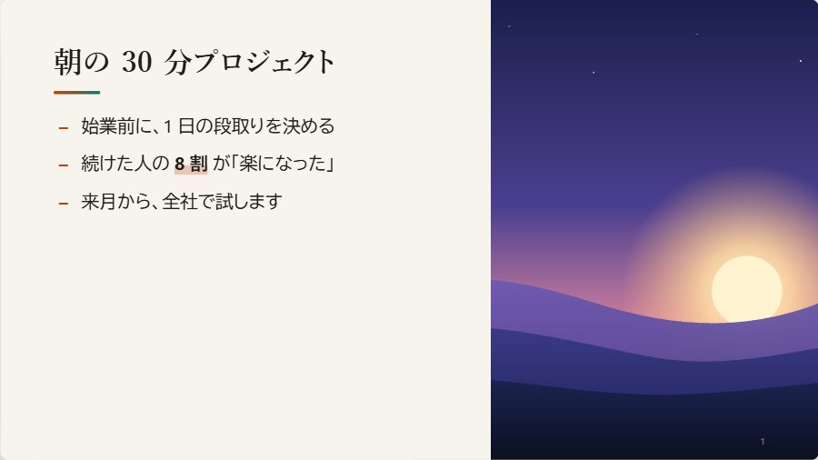{.shadow}

:::

左の原稿を書くだけで、右のスライドに。左右に並べる配置も自動です。

???
文章と画像が 1 枚ずつあると「画像：右」のレイアウトになる、というように、書いた内容に合わせてレイアウトが自動で決まります。
もちろん、デザインパネルで別のレイアウトに変えることもできます。

---

<!-- id: rules -->
## 覚える記号は、これだけ

| 原稿に書くこと | スライドでは |
| --- | --- |
| `# タイトル` | 表紙の大きな題 |
| `## 見出し` | 各スライドの見出し |
| `- 項目` | 箇条書き |
| `**強調**` | 太字 |
| `` | 画像（ドラッグ＆ドロップでも入る） |
| `---` | ここで次のスライドへ |

記号が苦手なら、ボタンから入れても同じです。

---

<!-- id: overview -->
## 左にプレビュー、右に原稿

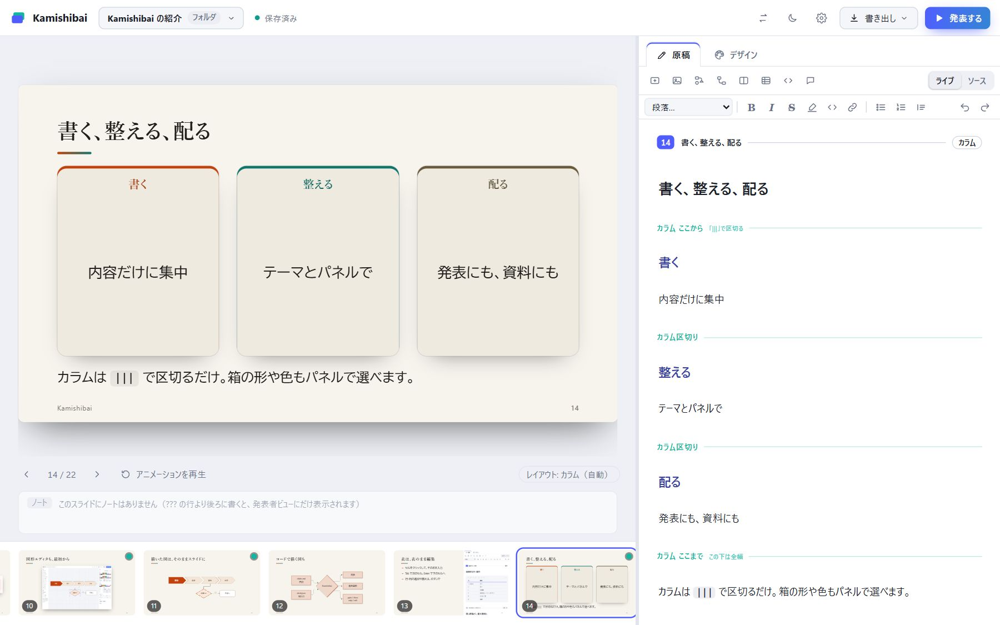{.shadow}

???
書いたそばから、左のスライドが整っていきます。
画面の左右は、上のバーのボタンで入れ替えられます。文字が小さいと感じたら、歯車の「設定」から画面の文字を大きくできます。

---

<!-- id: write -->
## 書く：記号を覚えなくても大丈夫

- 見出し・太字・リストは、ボタンからでも
- 書いた記号はその場で整形。カーソルのある行だけ記号が見える
- 画像はドラッグ＆ドロップか、貼り付けで
- 間違えても Ctrl + Z で、いつでも元どおり

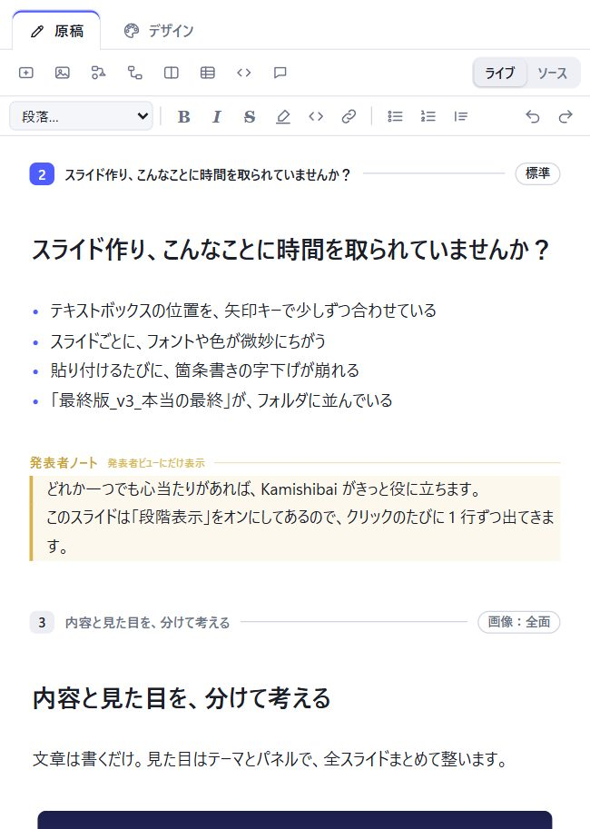

---

<!-- id: design -->
## 整える：テーマを選ぶだけ

- テーマを選ぶと、全スライドが一度に変わる
- 色・フォント・余白・動きは、パネルで調整
- 気になる 1 枚だけ、個別に変えることも

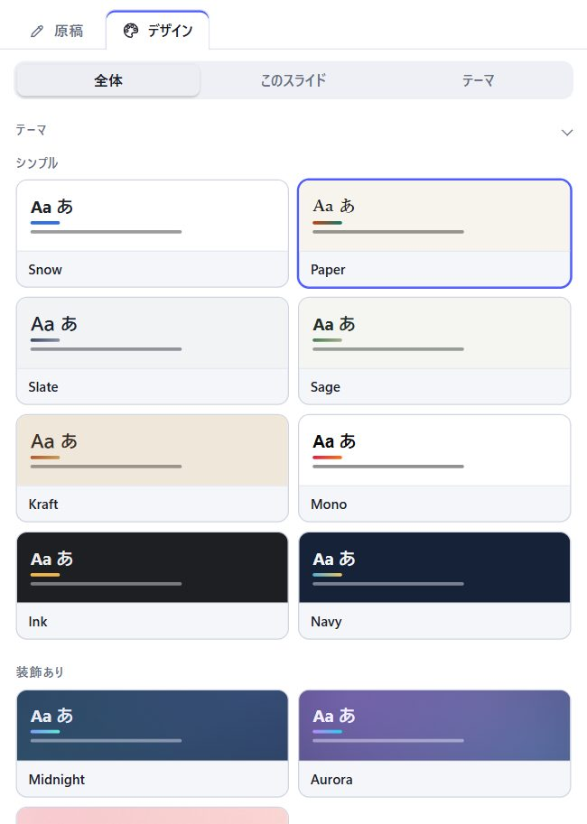

---

<!-- id: themes -->
## 同じ原稿、ちがう表情

::: columns

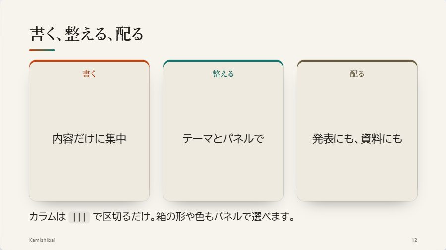{.shadow}

|||

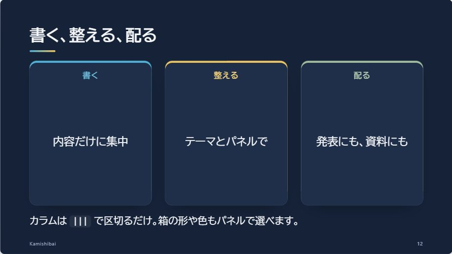{.shadow}

|||

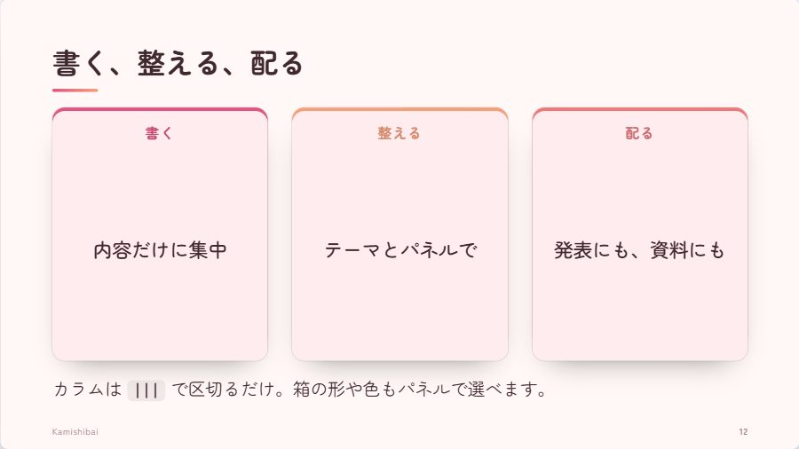{.shadow}

:::

テーマを切り替えても、原稿は 1 文字も変わりません。

---

<!-- id: diagram-editor -->
## 図形エディタも、最初から

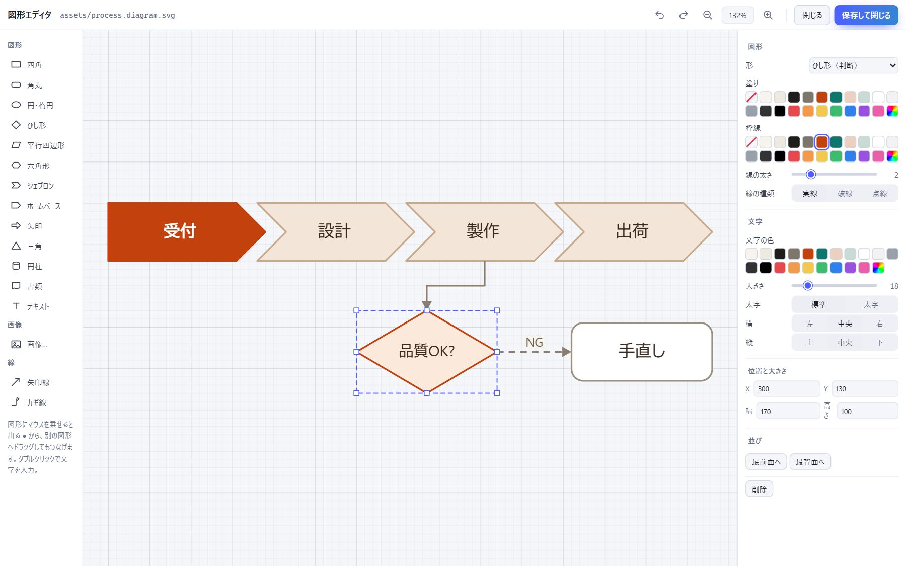{.shadow}

???
工程図もブロック図も、図形の ● から線を引いてつなぐだけ。写真も図の中に置けます。

---

<!-- id: diagram -->
## 描いた図は、そのままスライドに

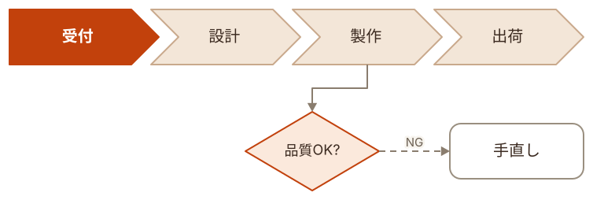

???
図をダブルクリックすると、図形エディタで開いて描き直せます。
.pptx / .odp に書き出すと、あとから編集できる図形として入ります。

---

## コードで描く図も

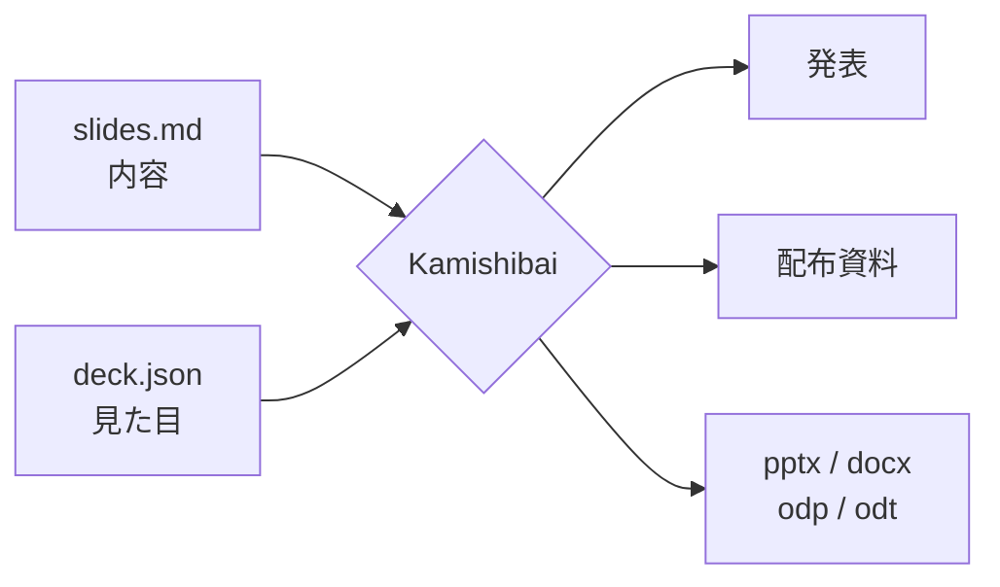

???
mermaid 記法で書いた図は、テーマの色で自動的に描かれます。

---

<!-- id: table -->
## 表は、表のまま編集

- セルをクリックして、そのまま入力
- Tab で次のセル、Enter で下のセルへ
- 行・列の追加や揃えは、ボタンで

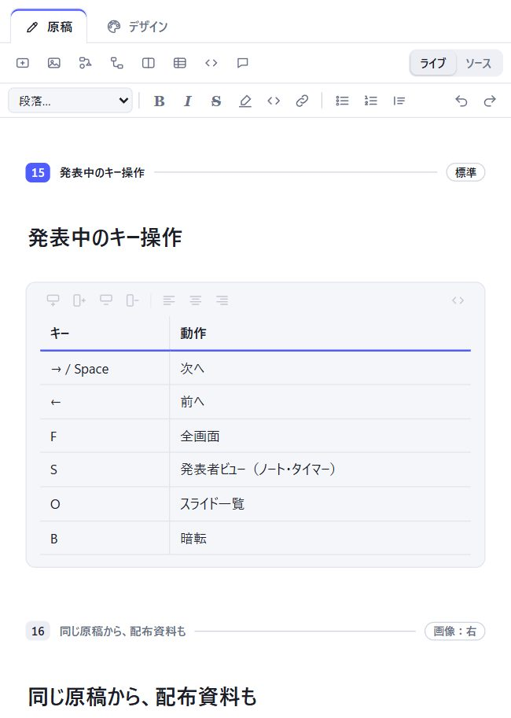

---

<!-- id: three -->
## 書く、整える、配る

::: columns

### 書く

内容だけに集中

|||

### 整える

テーマとパネルで

|||

### 配る

発表にも、資料にも

:::

カラムは `|||` で区切るだけ。箱の形や色もパネルで選べます。

---

<!-- id: export -->
## どこへでも、持ち出せる

::: columns

### HTML

ブラウザがあれば発表できる

|||

### PDF

印刷・配布に

|||

### pptx / docx

書き出した先でも編集できる

|||

### odp / odt

オープンな標準形式

:::

文字も図形も、書き出したあとで直せる形のまま出力します。

---

<!-- id: presenter -->
## 発表者ビューで、落ち着いて話せる

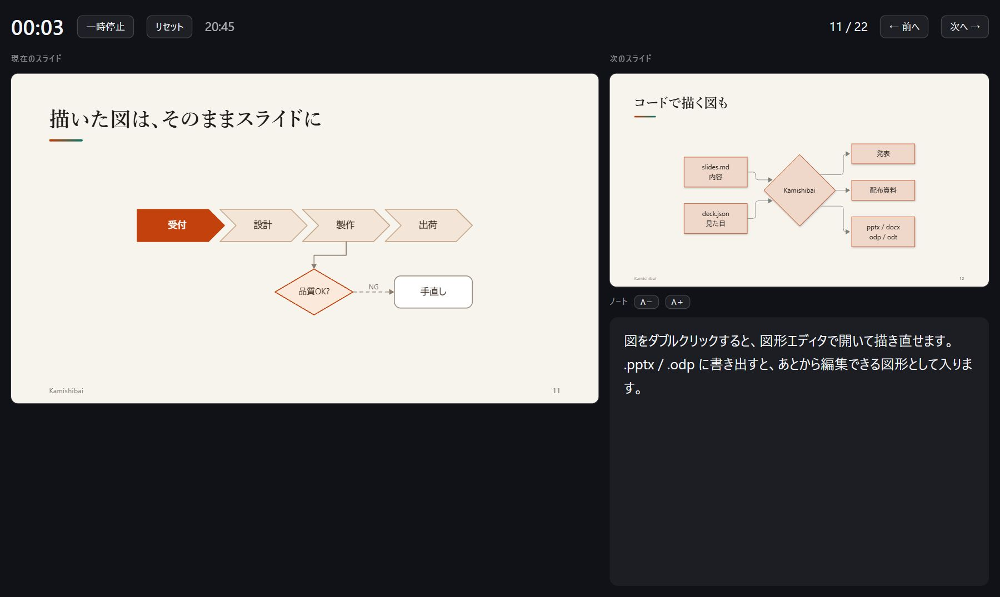{.shadow}

???
ノート・経過時間・次のスライドが、手元の画面にだけ出ます。発表画面で S キーを押すと開きます。

---

## 発表中のキー操作

| キー | 動作 |
| --- | --- |
| → / Space | 次へ |
| ← | 前へ |
| F | 全画面 |
| S | 発表者ビュー（ノート・タイマー） |
| O | スライド一覧 |
| B | 暗転 |

---

<!-- id: handout -->
## 同じ原稿から、配布資料も

- スライドを 1 本の読み物に組み直します
- 発表者ノートを本文として載せることも
- A4 の PDF や文書ファイルで、そのまま配れます

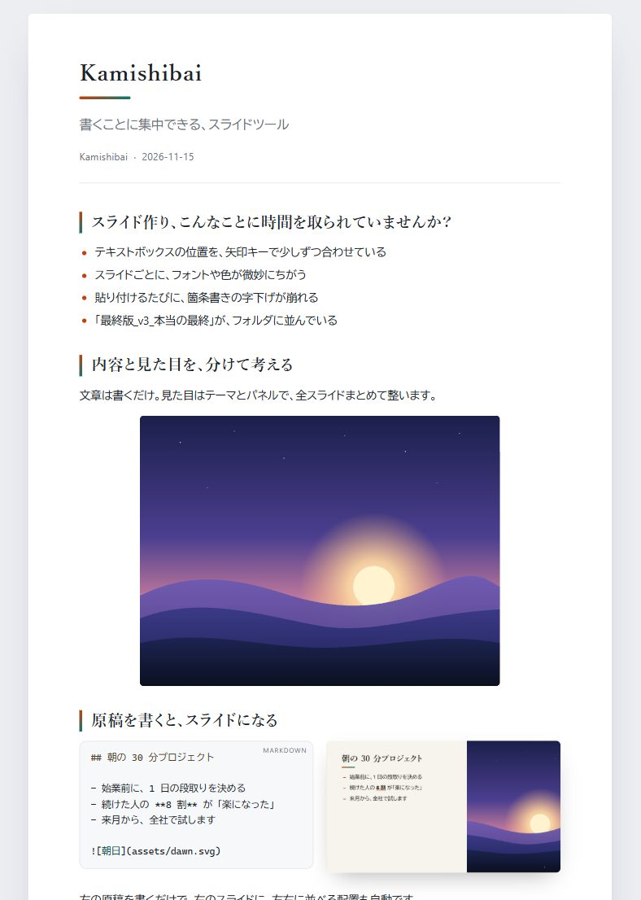

---

<!-- id: files -->
## ファイルは、あなたのもの

::: columns

### フォルダで保存

中身はただのテキストと画像。差分が読みやすく、バージョン管理にそのまま載せられる

|||

### 1 ファイルで保存

画像までまとめて .kami に。メールやチャットで渡すのに

:::

決まった保存場所はありません。好きな場所に置けます。

---

<!-- id: light -->
## 軽くて、どこでも動く

::: columns

### アプリ本体

数 MB

|||

### 追加のインストール

不要

|||

### ネット接続

不要

:::

???
アプリはファイル 1 つ。Windows に最初から入っている部品で動くので、ほかに何も入れなくて大丈夫です。

---

<!-- id: quote -->
> いいスライドは、内容が 8 割。
> 残りの 2 割は、内容の邪魔をしないこと。

---

<!-- id: start -->
# さあ、書きはじめましょう

左上のメニューから「新規作成」。このサンプルを書き換えて試すのも、もちろん OK です。
